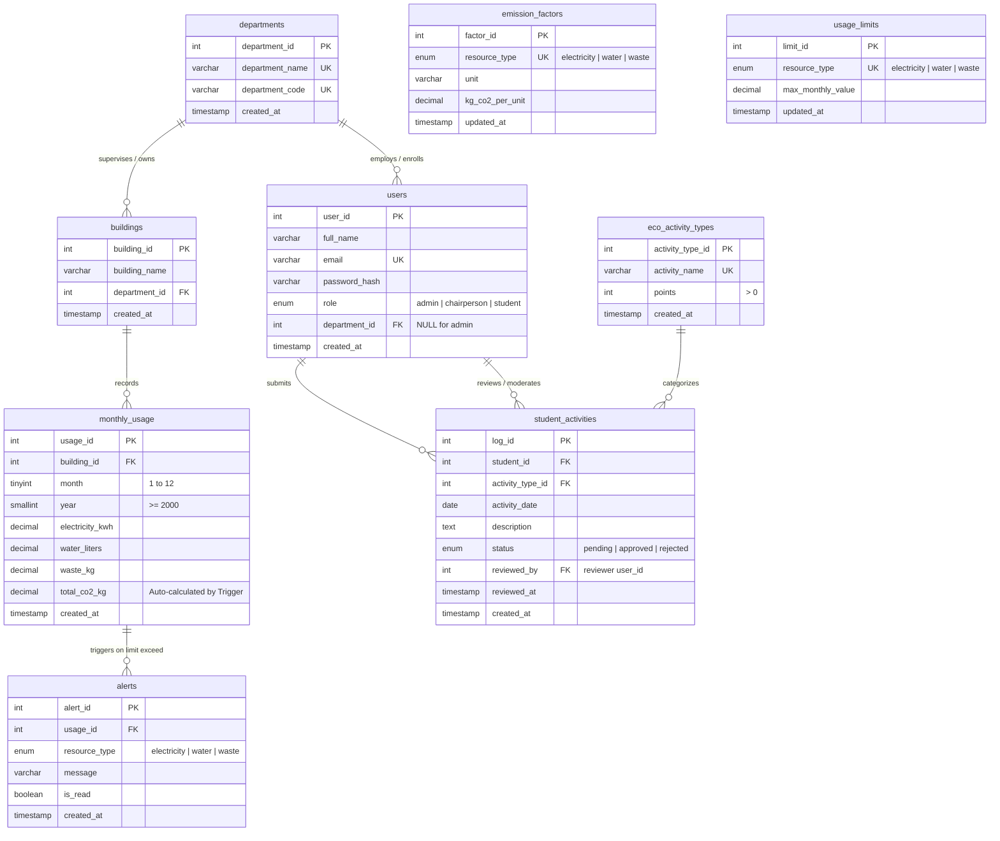

# CarbonLens: Entity-Relationship Diagram (ERD)
**Course:** CS-2104 Database Systems  
**Project:** CarbonLens: Smart Campus Carbon Footprint & Sustainability Tracker  

The database architecture is designed in **Third Normal Form (3NF)** consisting of **9 core relational tables**, enforced with primary keys, foreign keys with referential integrity rules (`ON DELETE CASCADE`, `ON DELETE SET NULL`, `ON DELETE RESTRICT`), unique constraints, and check constraints.

---

## Mermaid ERD Diagram

---

## Entity Relationship Cardinalities

| Relationship | Cardinality | Business Logic & Referential Integrity |
|---|---|---|
| **departments → buildings** | `1 : M` | One department manages one or many physical campus buildings. If a department is deleted, `ON DELETE CASCADE` removes child buildings. |
| **departments → users** | `1 : M` | One department has many students and one chairperson. Administrators are independent (`department_id = NULL`). If a department is deleted, `ON DELETE SET NULL` preserves user accounts. |
| **buildings → monthly_usage** | `1 : M` | Each building has at most one usage record per month/year (enforced by `UNIQUE(building_id, month, year)`). Deleting a building cascades to delete historical usage. |
| **monthly_usage → alerts** | `1 : M` | A single monthly usage entry can generate up to 3 alerts (electricity, water, waste) via `trg_usage_alert_insert`. Cascade deleted if usage is removed. |
| **users (students) → student_activities** | `1 : M` | A student logs multiple eco-actions. `ON DELETE CASCADE` clears logs if a student account is removed. |
| **users (reviewers) → student_activities** | `1 : M` | A chairperson or admin reviews activities. `ON DELETE SET NULL` preserves student activity logs even if a staff account is deleted. |
| **eco_activity_types → student_activities** | `1 : M` | Lookup table defining standard point rewards. `ON DELETE RESTRICT` protects against deleting activity types currently referenced in student logs. |
| **emission_factors & usage_limits** | *Configuration* | Standalone lookup tables storing multipliers and thresholds utilized by MySQL database triggers. |
